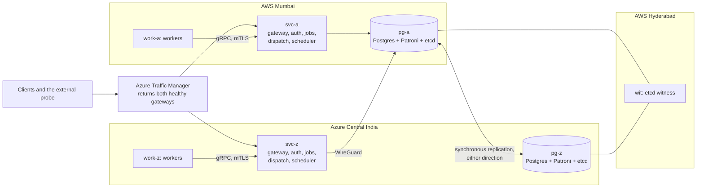
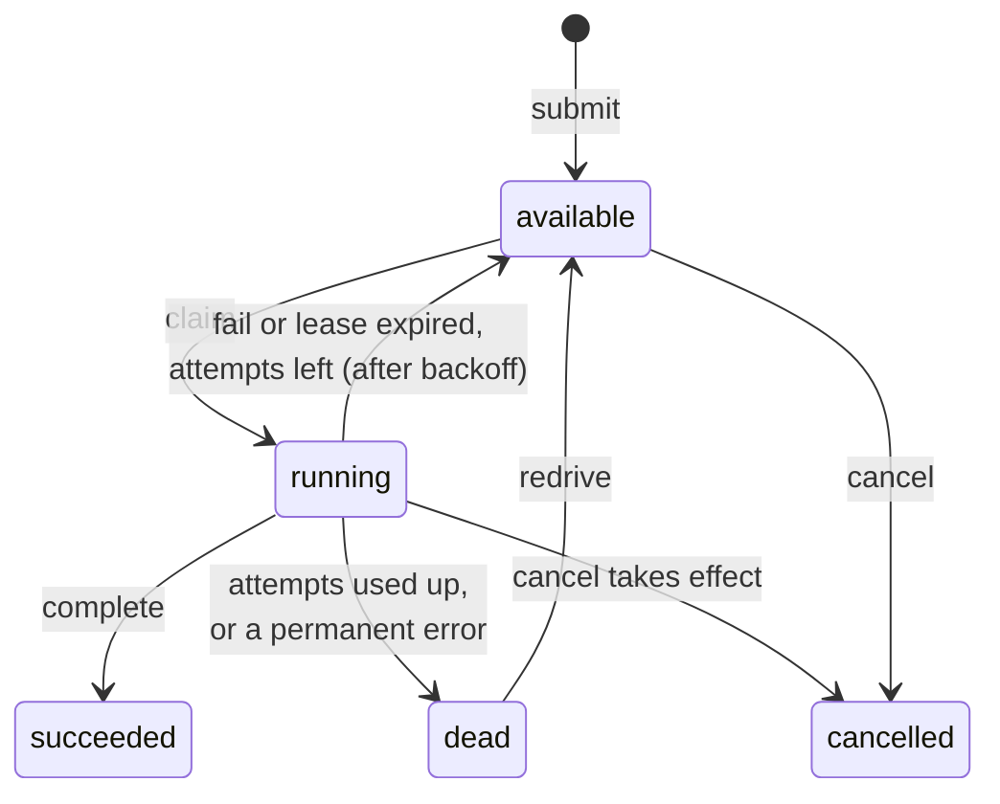
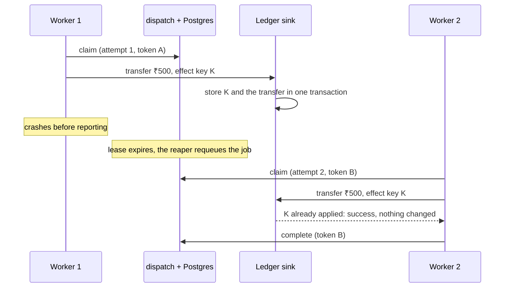
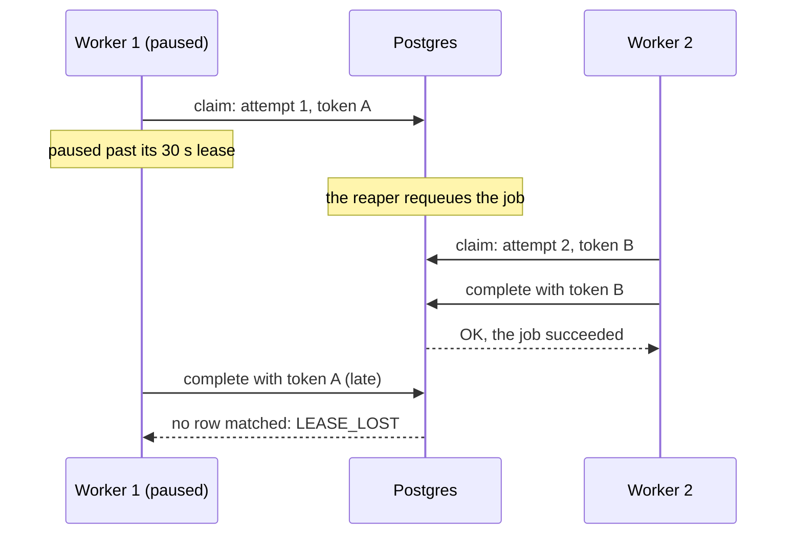

# Design

task-queue is a distributed job scheduler written in Go. It runs across AWS Mumbai and Azure Central India, and PostgreSQL is its only queue. This document explains the decisions behind its central claim, what each decision costs, and where the claim stops. Every number here was measured, and each section links to the run that produced it.

> **The claim.** The scheduler never loses a job it has acknowledged and never records a job's result twice. Each job's effect happens at most once, and exactly once if the job succeeds, at every destination that checks the job's effect key. This holds through crashes and pauses of any process or VM, database failover, a full network split between the clouds, and the loss of either cloud. Planned work (deploys, reboots, VM replacements) never takes the service down. An automated chaos test checks every guarantee, and a deliberately broken build proves that each check can fail.

Contents:

1. [The system in one picture](#1-the-system-in-one-picture)
2. [The fault model](#2-the-fault-model)
3. [Postgres as the queue: `SKIP LOCKED` instead of a broker](#3-postgres-as-the-queue-skip-locked-instead-of-a-broker)
4. [At-least-once execution, effects once](#4-at-least-once-execution-effects-once)
5. [Fencing tokens](#5-fencing-tokens)
6. [One clock, and why safety doesn't need it](#6-one-clock-and-why-safety-doesnt-need-it)
7. [Replication: synchronous when possible](#7-replication-synchronous-when-possible)
8. [Zero-downtime deploys, and the probe that proves them](#8-zero-downtime-deploys-and-the-probe-that-proves-them)
9. [How the claim is checked](#9-how-the-claim-is-checked)
10. [Known limits](#10-known-limits)

---

## 1. The system in one picture



- **`gateway`** is the only public entry point: TLS, JWT check, per-user rate limit, and the dashboard.
- **`jobs`** serves the job API (submit, get, list, cancel, redrive, schedules). **`dispatch`** serves workers: claim, heartbeat, complete and fail, each one SQL statement. **`scheduler`** runs two chores on the elected leader: the lease reaper and cron.
- **Workers** talk only to `dispatch`, so database credentials never leave the service tier.
- Every stateless service runs in both clouds. Postgres runs on `pg-a` and `pg-z` under Patroni, and a third etcd member on `wit` breaks ties.

`jobs`, `dispatch` and `scheduler` are three processes of **one bounded context, and they share the `jobs` database on purpose**. Claiming a job changes its state, opens an attempt and starts a lease, and that has to be one transaction. Splitting the data across services would replace a transaction with a distributed protocol. `auth` is a separate context with its own database and its own credentials. Both databases live in the same Postgres cluster, so the system has a single failover story.

---

## 2. The fault model

A guarantee means nothing without the faults it is promised against.

**Tolerated.** The safety guarantees hold through any combination of:

- a crash (`kill -9`) of any process at any instruction, or a VM stopped without warning;
- a pause of any length in any process or VM (GC, `SIGSTOP`, a frozen VM);
- lost, delayed, duplicated or reordered messages, and any network partition, up to a full split between AWS and Azure;
- the loss of either database node, either whole cloud region, or the etcd witness, all recovered automatically;
- a wrong clock on any machine (see [section 6](#6-one-clock-and-why-safety-doesnt-need-it)).

**Not tolerated** (see [section 10](#10-known-limits)):

- double failures: losing the primary's disk while the standby is out of sync, or losing two of the three etcd sites;
- operator mistakes and bugs that write wrong values;
- malicious workers (a worker with a valid certificate can report success without doing the work);
- effects sent to destinations that don't check the effect key.

**Safety and liveness are separate.** *Safety* means nothing acknowledged is lost and nothing is recorded or applied twice. It holds under every tolerated fault, with no exceptions and no waiting. *Liveness* means jobs keep finishing, and it needs more: a worker for the job's queue, a dispatcher it can reach, and a database primary that dispatcher can reach. During a cut between the clouds, the side without the etcd majority stops making progress, and that is the intended behaviour. Its workers idle and its jobs wait. **Safety never waits on liveness.** The first set of cloud experiments ([Act 1](results/act1-fragility.md)) lost availability in every scenario and never lost safety. The second set ([Act 2](results/act2-resilience.md)) removed the single points of failure one layer at a time.

---

## 3. Postgres as the queue: `SKIP LOCKED` instead of a broker

**The decision.** Jobs live in one Postgres table, and workers claim them with `SELECT … FOR UPDATE SKIP LOCKED`. No message broker is involved.

**Why.** A job here is not only a message. It has an idempotency key, a state, a lease, a history of attempts, a schedule tick, and an owner. Each of these has to change atomically with the others. In Postgres the important operations are each one statement:

```sql
-- claim (internal/queue/lease.go): pick, lease and log the attempt in one round trip
WITH next AS MATERIALIZED (
  SELECT id FROM jobs
  WHERE state = 'available' AND run_at <= now() AND queue = ANY($1) AND type = ANY($2)
    AND (affinity IS NULL OR affinity = $3 OR run_at <= now() - $4::interval)
  ORDER BY priority DESC, run_at, id
  LIMIT $5
  FOR UPDATE SKIP LOCKED                     -- skip rows another claimer is taking
), claimed AS (
  UPDATE jobs j SET state = 'running', attempt = j.attempt + 1,
                    lease_token = gen_random_uuid(), ...
  FROM next WHERE j.id = next.id AND j.state = 'available'   -- no double claim under any plan
  RETURNING j.*
), logged AS (
  INSERT INTO job_attempts (job_id, attempt, lease_token, node_id, started_at)
  SELECT id, attempt, lease_token, node_id, now() FROM claimed
)
SELECT ... FROM claimed;
```

A broker would give at-least-once delivery of a message. The idempotency table, the state machine, the attempt log and cron would still need a database, so every operation would span two systems that fail separately. That pair needs an outbox, a consumer-side dedup table, and two failover stories. Using Postgres alone removes all of that. Uniqueness, state transitions and fencing become constraints and `WHERE` clauses that a crash can't skip. The database's `CHECK` constraints refuse any row that doesn't fit the state machine:



Every claim, heartbeat and completion is a single statement. This matters because a dispatcher may sit in a different cloud from the primary, which costs 5.5 ms per round trip.

**The measured ceiling.** Jobs that do no work, so the numbers measure the scheduler's own overhead:

| Where | Synchronous replication | Asynchronous replication | Report |
| --- | --- | --- | --- |
| One laptop, 8 workers, 5.5 ms simulated round trip | about 540 jobs/s, p50 12 ms | about 1,270 jobs/s, p50 5 ms | [load-local.md](results/load-local.md) |
| Production, 2 worker VMs, primary in Azure | 101 jobs/s, p50 22 ms | 307 jobs/s, p50 4 ms | [load-cloud.md](results/load-cloud.md) |

**The limit is the commit path, not `SKIP LOCKED`.** Row-lock waits stayed at or below 4% in every local run, so concurrent claimers almost never waited for each other. The time goes to commits. Each job costs at least two commits: the claim (batched across jobs) and the completion (one per job). With synchronous replication, each commit waits for the standby in the other cloud: `IPC:SyncRep` took 63–80% of the waiting. Without it, the waits move to writing and flushing the write-ahead log.

**What would raise the ceiling,** in order of payoff:

1. Complete in batches, as heartbeats already do: one commit for many results.
2. Tune autovacuum for `jobs` and archive finished jobs. Every update changes `state`, which the claim index covers, so no update is HOT. A 10,000-job drain left up to 40,000 dead tuples.
3. Run more `dispatch` instances, and keep the primary in the same cloud as most of the workers.

**When to choose a broker instead:** at tens of thousands of jobs per second, for fan-out to many consumers, or for event streams where the order within a partition matters. This scheduler is built for work measured in hundreds of jobs per second that must not be lost or applied twice.

---

## 4. At-least-once execution, effects once

**Exactly-once execution is impossible.** A worker can always crash after doing the work and before reporting it. Nothing the scheduler does can tell "crashed before the effect" from "crashed after it", so it must run the job again.



So the scheduler promises **at-least-once execution** and provides two keys that make repeating safe:

- **The idempotency key**, for submission. It is required on every submit. `UNIQUE (owner_id, idempotency_key)` makes a retried submit return the original job. The original request is stored as `jsonb`, so a key reused for a different request gets `409`. Any error after `COMMIT` was sent returns `503 outcome unknown: retry with the same Idempotency-Key`, and a retry with the same key is always safe.
- **The effect key**, for the job's effect. It is `owner_id:idempotency_key` (`queue.Claimed.EffectKey`), so it stays the same across every attempt, every redrive and every resubmission. Each worker handler passes it to its destination. The destination stores the key **in the same transaction as the effect** (`internal/sinks/sinks.go`), so the effect and its key are stored together or not at all. A key that is already present means "already done": the destination applies nothing and still reports success, so the retry completes the job.

The chaos test checks this at three test destinations. They absorb duplicates in every run, for example 85 in the production run that stopped AWS Mumbai. Across all twelve production runs, the checker found no effect applied twice. For the ledger, each account's balance must also equal its opening balance plus its recorded transfers.

**Email is the counterexample, and the project keeps it on purpose.** SMTP has no idempotency. The `email.send` handler derives the `Message-ID` from the effect key, which lets a recipient notice a duplicate but can't stop it being delivered. The checker counts duplicate deliveries and reports them as expected at-least-once behaviour. Across the 30 recorded chaos runs there were 6 duplicate emails, in the same runs where the ledger and webhook sinks absorbed dozens of duplicates each. Only the destination can make an effect happen once. The scheduler's job is to hand the destination a key that makes that possible.

---

## 5. Fencing tokens

A lease says *when* a worker should give a job up. It can't stop a worker that doesn't know its lease has expired. A worker paused for 40 s (GC, a frozen VM, `SIGSTOP`) wakes up believing it still holds the job, while another worker is already running it. Timeouts can't fix this, because a pause can be longer than any timeout.

**Each attempt gets a random `lease_token`, and every write checks it in the same statement that makes the change:**

```sql
UPDATE jobs SET state = 'succeeded', ...
WHERE id = $1 AND lease_token = $2 AND state = 'running'
```



The late write matches no row and changes nothing. A complete that is retried after its response was lost is recognised by its token in `job_attempts` and returns OK, so retrying is always safe. Heartbeats are fenced the same way. A heartbeat that matches no row tells the worker's SDK to cancel the handler.

The production chaos runs rejected 290–410 late results per run, and none of them was recorded. The `mutant_nofence` build replaces the token check with a condition that is always true. The checker caught it at once: G3 failed with 32 jobs whose successful attempt was not the last attempt ([report](results/chaos-r1791462536690885800-mutant_nofence.md)).

**The scheduler leader is fenced the same way, with an epoch.** The leader lease is a row with `holder`, `epoch` and `expires_at`, and each takeover increments the epoch. Every chore transaction starts with:

```sql
SELECT 1 FROM leader_leases
WHERE name = 'scheduler' AND holder = $me AND epoch = $epoch AND expires_at > now()
FOR SHARE;
```

A stale leader finds no row, rolls back and steps down. Because of `FOR SHARE`, a takeover has to wait until a running chore commits, so chores of two epochs never overlap. The chaos test couldn't catch the `mutant_noepoch` build. A leader that resumes from a long pause fails its renewal and steps down before running any chore, so a pause would have to land in the tiny gap between a renewal and a chore. A deterministic unit test (`TestPausedLeaderIsFenced`) covers that gap instead, and the [bug diary](bugs.md) records why. Correctness doesn't rest on the epoch: the reaper is token-fenced and cron ticks have a unique key. The epoch only prevents wasted and confusing work.

---

## 6. One clock, and why safety doesn't need it

**Every time the system decides with is Postgres `now()`:** lease expiry, deadlines, `run_at`, backoff and cron ticks. No VM's clock is used. Clocks in two clouds drift apart, and a single authority removes a whole class of bugs, such as a job running early because a worker's clock is fast.

**No safety guarantee depends on any clock, including the database's.** A wrong clock changes only *when* things happen:

| If the clock is wrong… | What happens | Why safety holds |
| --- | --- | --- |
| Leases expire too early | A second worker runs a job while the first still works on it | Fencing tokens: only the current token can record a result |
| Leases expire too late | A crashed worker's job waits longer to be retried | Only liveness is affected |
| Cron ticks fire early or late | A tick's job runs at the wrong time | The tick's key `(schedule_id, tick_at)` is still unique, so it is never doubled or skipped |
| A leader's lease looks valid for too long | Two schedulers both believe they lead | The epoch fence: only one epoch's chores commit |

Two narrower uses of time remain. JWT expiry is checked against the VM's own clock, with 60 s of leeway and chrony running everywhere. After a failover, the new primary's clock takes over. The skew between the two database hosts is milliseconds, and leases are measured in seconds.

The [chaos harness](#9-how-the-claim-is-checked) relies on this split. It never has to make timing "right" for the checker to pass. Faults land at random moments, and only the order of commits matters.

---

## 7. Replication: synchronous when possible

With a database in each cloud, the system has to choose what a commit means while the clouds can't reach each other. There are three options:

| Mode | A commit returns when… | During a cut between the clouds | After the primary dies |
| --- | --- | --- | --- |
| Asynchronous | the primary has it | writes continue | **acknowledged jobs can be lost** (the standby may be behind) |
| Strict synchronous | the standby has it too | **every write stops** until the link returns | nothing is lost |
| **Synchronous when possible** (chosen) | the standby has it, while the standby is healthy | writes stop for about 5 s, then continue without the standby | nothing is lost, because only an in-sync standby is promoted |

**Strict mode would turn every cut, and every standby reboot, into downtime.** That breaks the promise that planned work never takes the service down. The chosen mode is Patroni's `synchronous_mode: true` with `synchronous_mode_strict: false`. While the standby is healthy, every commit waits for it, so an acknowledged job exists in both clouds. If the standby stops answering, `wal_sender_timeout` (5 s, down from the default 60 s) drops it, and Patroni turns synchronous replication off so that writes continue. Synchronous mode comes back on when the standby catches up. **Patroni never promotes a standby that was out of sync.**

**Who may promote** is decided by etcd, with one member on `pg-a`, one on `pg-z` and one on the witness `wit` in AWS Hyderabad. A failover needs two of the three. During a cut, the side with the majority keeps or takes the primary, and a primary that loses etcd demotes itself. That prevents split brain.

**What it costs:**

- **Throughput.** Synchronous commit costs about half the throughput locally and two-thirds in production: 101 against 307 jobs/s ([section 3](#3-postgres-as-the-queue-skip-locked-instead-of-a-broker)). Every commit waits one round trip between the clouds.
- **Time with no primary.** After a crash, Patroni promotes the standby only once the dead leader's key in etcd expires, and Patroni won't accept a `ttl` below 20 s. The services retry database calls for up to 30 s, so requests in that window succeed slowly. A client with a 10 s timeout, such as the probe, sees them fail. Production failovers each cost 113–114 probe requests, all sent within about 17 s ([act2-resilience.md](results/act2-resilience.md)).

**The double failure it leaves.** The standby is out of sync from the moment it stops answering until it catches up. If the primary's disk is lost inside that window, the jobs acknowledged during the window are lost with it. This is a double failure: first the standby, then the primary's disk. The project accepts this risk in exchange for staying writable during a partition, and states it as a limit rather than hiding it. G1 therefore reads: *an acknowledged job is never lost, unless the primary's disk is lost while the standby is out of sync.* No experiment produced that state. Every failover and cut in weeks 13–15 passed G1 ([act2-database.md](results/act2-database.md)).

---

## 8. Zero-downtime deploys, and the probe that proves them

**The promise is exact:** a deploy, a reboot or a VM replacement fails **zero** requests. Requests may be slower for a few seconds, but none may fail. A crash is different. It can fail the requests that were in flight on the crashed component, and clients retry those with the same key.

**How a release goes out** (`git push origin main:release`, then `release.yml` and `deploy/release/rollout.sh`):

1. **Verify:** CI, plus a 5-minute chaos run that must pass.
2. **Migrate:** expand/contract migrations only, so the old code keeps working on the new schema.
3. **Roll out one VM at a time.** Each stateless service has a twin in the other cloud, which serves while it restarts:
   1. **Drain.** For a gateway, disable its Traffic Manager endpoint and wait 60 s, six times the 10 s DNS TTL. The gateway then closes idle connections, so clients reconnect to its twin. Any other service turns its `/readyz` off and waits 10 s.
   2. **Stop gracefully.** On `SIGTERM`, servers finish their in-flight requests, and workers stop claiming and finish their jobs.
   3. **Start** the new version, wait for `/readyz`, and re-enable the endpoint once Traffic Manager sees it healthy.
4. **Smoke test:** one job pinned to each cloud must succeed, and every `/version` must report the new commit.
5. **Roll back automatically** if any step fails, or if the probe records a single failed request.

The database VMs are never restarted in place. A new database image is rolled out by replacing the replica, then switching over and replacing the old primary (`make infra REPLACE=…`). Replacing the primary that way failed 0 of 24,385 probe requests.

**The probe is what turns "zero downtime" from a claim into a measurement.** During every rollout, it runs on a GitHub runner outside both clouds. It sends about 10 requests a second: `/version`, an authenticated list, and an idempotent submit. Every request resolves DNS afresh, opens a new connection, has a 10 s timeout and is **never retried**. A retry would hide exactly the failures the probe exists to find. The probe's verdict fails the release.

**Results:** 16 releases in a row, from week 12 to week 15, deployed under the probe with **59,599 requests and 0 failed**. For comparison, the twelve faults in production failed 594 of 47,780 probe requests (1.24%). Every one of those was sent within 43 s of a fault starting, and each one fits one of four causes: in flight on a VM as it died, no primary until promotion, DNS still returning the cut-off side, or DNS returning only the dead gateway ([act2-resilience.md](results/act2-resilience.md)).

Several bugs taught the same lesson: **"ready" must mean "can serve the caller's first request"**. A gateway reported ready before its upstreams were ready. A new gateway asked an old `auth` for a route that `auth` didn't have yet, because during a rolling deploy a new client always meets an old server. A chaos step's `| tee` hid a failing exit status. Each one is in the [bug diary](bugs.md).

---

## 9. How the claim is checked

`cmd/torture` runs in four steps, locally against Compose or in production through the public name:

1. **Load.** It submits thousands of mixed jobs as a real client would. About 10% repeat a key, some of them with a changed body. Every acknowledgement is fsynced to a log before it counts.
2. **Faults.** It applies kills, pauses past the lease, network cuts and database crashes on a seeded timetable, or a scripted scenario such as stopping a whole cloud.
3. **Quiesce.** It waits until every due job has finished and every due cron tick exists.
4. **Check.** It verifies G1–G8 against three independent sources: its own acknowledgement log, the jobs database, and the sinks.

Two rules keep the checker honest:

- **A guarantee whose fault never fired fails.** Each line of the report states how many times its fault was exercised, for example 359 late results rejected or 85 duplicates absorbed.
- **Every mechanism has a mutant build** (`-tags mutant_<name>`) that removes it, and the checker must fail it. There are six mutants. Four failed the chaos checker on exactly the guarantee they break: `nofence` on G3, `nokey` on G2, `noeffectkey` on G4, and `ackfirst` on G1. The other two remove one layer of a defence the chaos test can't get past. `noepoch` is explained in [section 5](#5-fencing-tokens). `notick` removes the tick's row lock and uniqueness, but one leader still ticks at a time. Both fail deterministic tests instead (`TestPausedLeaderIsFenced` and `TestTickSchedulesConcurrentlyNoDuplicates`), and `mutants.sh` requires all six to be caught.

A check that can't fail proves nothing. The same rule was later applied to the cleanup sweep, the experiment probe and CI's chaos gate, and each of them once reported success when it couldn't see. They now fail instead.

---

## 10. Known limits

These are scope decisions, stated openly:

- **Availability is preferred during a partition.** Losing the primary's disk while the standby is out of sync loses the jobs acknowledged in that window (a double failure; [section 7](#7-replication-synchronous-when-possible)).
- **Crashes aren't free.** A crashed primary leaves about 20 s with no primary. A cut with the primary on the cut-off side, or the loss of the primary's cloud, failed probe requests for 31–39 s. Planned events fail none.
- **The etcd witness is also in AWS,** in another region. An outage of all of AWS removes two of the three votes, so Azure can't promote itself. A witness on a third provider would fix this.
- **Both regions are in western India.** The two providers are independent, but the geography is not. The regions were chosen for their 5.5 ms round trip, which keeps synchronous commits cheap.
- **The public name depends on Azure Traffic Manager,** even while Azure's VMs are down.
- **Workers are trusted.** A worker with a valid certificate can report success without doing the work. Effects at destinations that don't check the effect key are at-least-once.
- **Rate limits are per gateway,** so two gateways allow up to twice the limit.
- **The throughput ceiling is the commit path:** 101 jobs/s in production with synchronous replication, on the current layout ([section 3](#3-postgres-as-the-queue-skip-locked-instead-of-a-broker)).
- **There are no backups beyond the standby,** and jobs are never purged, so idempotency keys never expire. The data is disposable by design.
- **`ops-a`** (the harness, sinks and monitoring) is test infrastructure and is never faulted.

---

**Further reading:** one page per decision, in [decisions/](decisions/); the plan and the guarantees in full, in [full_plan(v4).md](../full_plan(v4).md); the release and availability design, in [deployment_plan.md](../deployment_plan.md); how each week was built, in [journey.md](journey.md); every bug and what it taught, in [bugs.md](bugs.md); and the raw evidence, in [results/](results/).
