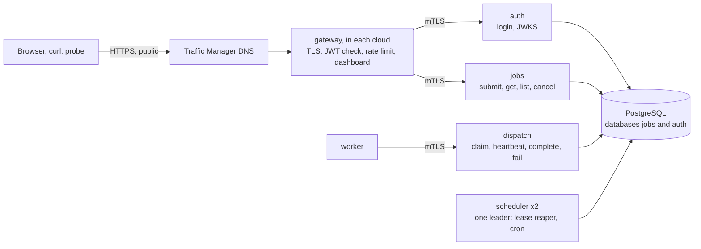

# How this was built: weeks 1–16

A learning log for the project so far: what each week built, the idea behind it, how it was proven, and what broke along the way. The plan is in [full_plan(v4).md](../full_plan(v4).md), the evidence in [results/](results/), and every bug in [bugs.md](bugs.md). This file ties them together.

---

## 1. The big picture

**What it is.** A distributed job scheduler. Clients submit jobs ("send this webhook", "move ₹500 between wallets", "build the daily report at 09:00"). Workers in two clouds, AWS Mumbai and Azure Central India, run them. PostgreSQL is the only queue: there is no message broker.

**The claim it has to earn.** It never loses a job it has acknowledged, and it never records a job's result twice. Each job's effect happens at most once, and exactly once if the job succeeds, at every destination that checks the job's effect key. That has to hold through crashes, pauses, database restarts and network splits, and an automated test checks every part of it.

**The honest caveat.** Exactly-once *execution* is impossible: a worker can always crash after doing the work but before reporting it. So the system gives at-least-once execution, plus **effect keys** that let a destination apply each effect once.

### The eight guarantees

| # | Guarantee | The mechanism, in one line |
| --- | --- | --- |
| G1 | An acknowledged job is never lost | Acknowledge only after `COMMIT`; replicate synchronously before committing |
| G2 | Same key, same job; a changed request gets `409` | `UNIQUE (owner_id, idempotency_key)` plus a stored copy of the request |
| G3 | Only the current lease holder records a result | A random `lease_token` per attempt, checked in the same `UPDATE` (a *fencing token*) |
| G4 | Effects at most once, exactly once on success | The destination stores the effect key in the same transaction as the effect |
| G5 | Every job ends succeeded, dead or cancelled | Leases expire, a reaper requeues them, `max_attempts` caps retries |
| G6 | Cron: one job per tick, none skipped | `PRIMARY KEY (schedule_id, tick_at)`, written with the job |
| G7 | One leader per epoch | A leader lease with an `epoch`, re-checked at the start of every chore |
| G8 | No attempt starts before its `run_at` | The claim query, on the database's clock |

### The services



Every internal call is mutual TLS (mTLS): each service has a certificate from the project's own certificate authority, and refuses callers without one.

---

## 2. Week by week

### Weeks 1–2: foundations and the job API

- **Built:** the Go module, Protobuf for the worker API (`buf`), database migrations (`goose`), Docker Compose with PostgreSQL 18, a Next.js skeleton, and CI (`go vet`, race-detector tests, `buf lint`, `govulncheck`, the web build). Then the job API: submit with a required `Idempotency-Key`, get, list with keyset pagination, cancel.
- **Measured:** the round trip between AWS Mumbai and Azure Central India is **5.47 ms** ([accounts.md](results/accounts.md)). Every later latency number depends on it.
- **Ideas:**
  - **Idempotent submission (G2).** A client that times out doesn't know whether its job was created, so it retries with the same key. The database's `UNIQUE (owner_id, idempotency_key)` turns that retry into "return the original job". The stored copy of the request catches a key reused for something different: `409`.
  - **UUIDv7 IDs.** Time-ordered, so new rows land at the end of the index, and safe to generate anywhere.
  - **Isolation.** `owner_id` comes from the verified token, never from the request body. Another user's job returns `404`, not `403`, so its existence doesn't leak.
- **Proven by:** 50 concurrent identical submits create exactly one job, and the database's `CHECK` constraints reject every illegal state change.

### Week 3: dispatch, leases and the worker SDK

- **Built:** `dispatch`, the only service workers talk to. It offers a long-poll claim, heartbeats, complete and fail, plus a Go worker SDK.
- **Ideas:**
  - **`SELECT … FOR UPDATE SKIP LOCKED`.** Many dispatchers claim from the same table at once. `SKIP LOCKED` makes each claimer skip rows another one is taking instead of queueing behind them. This is what lets Postgres act as a queue.
  - **Leases.** A claimed job belongs to its worker for 30 s, and heartbeats extend that. If the worker dies, the lease runs out and the job can run again.
  - **Fencing tokens (G3).** Each attempt gets a random `lease_token`. Complete and fail run `UPDATE … WHERE lease_token = $token`, so a worker that was paused past its lease ("zombie") changes nothing: its token is stale. A complete that's retried after the response was lost is recognised from `job_attempts` and returns OK.
  - **One round trip.** Every claim, heartbeat and completion is a single SQL statement, which matters once a dispatcher sits in another cloud from the database.
- **Proven by:** 5 workers and 1,000 jobs give exactly one attempt per job, 20 runs in a row under the race detector.

### Week 4: retries, backoff, the reaper, redrive

- **Built:** retries with capped exponential backoff and full jitter, deadlines, dead letters and redrive, priorities, delayed jobs, cooperative cancel, and the **lease reaper**: one statement that requeues expired leases and is safe with any number of copies running.
- **Bug:** the backoff formula overflowed Postgres's interval type from about attempt 44, which would have left the job stuck. The test that tries attempts 1 to 1,000 found it; the fix caps the exponent.

### Week 5: leader election and cron

- **Built:** two schedulers elect a leader with a lease row (`holder`, `epoch`, `expires_at`). Only the leader runs chores: the reaper, and cron ticks.
- **Ideas:**
  - **Epochs as fencing tokens (G7).** Each takeover increments the epoch. Every chore transaction starts with `SELECT … FOR SHARE` on the lease row at its own epoch. A paused old leader finds no row and changes nothing, and `FOR SHARE` makes a takeover wait until a running chore commits, so chores of two epochs never overlap.
  - **Exactly-once cron (G6).** Each tick is a row with primary key `(schedule_id, tick_at)`, inserted in the same transaction as its job. Two leaders can't both create one tick, and missed ticks are caught up.
- **Bug:** daylight saving. On the night clocks fall back, `01:30` happens twice, and the cron library fired twice. A tick now fires at most once per wall-clock time.

### Week 6: auth, the gateway, mTLS

- **Built:**
  - `auth`: argon2id passwords, EdDSA-signed JWTs with a key ID, and a JWKS endpoint that publishes the public keys.
  - The gateway: routing, a JWT check, a per-user rate limit, a 64 KB body limit, and a browser cookie with an `Origin` check.
  - A project CA, with mTLS everywhere and Postgres over TLS.
- **Ideas:**
  - **Fail closed.** A service that can't fetch the signing keys rejects every request.
  - **Accept only the expected algorithm.** Tokens claiming `alg: none` or using another key are refused, and tests check exactly those cases.

### Week 7: the sinks, the chaos harness, the checker, the mutants

This is the centerpiece, and the reason every later claim can be trusted.

- **Sinks** stand in for external systems: a ledger, a webhook receiver that fails at random (before or after recording), and a digest store. Each stores the effect key in the same transaction as the effect (G4). Email through Mailpit is the deliberate counterexample: SMTP can't deduplicate, so duplicates are counted, not hidden.
- **The harness, `cmd/torture`:**
  1. **Load.** It submits thousands of mixed jobs through the gateway, as a real client would, writing every acknowledgement to a log on disk before counting it.
  2. **Faults.** On a timetable set by a random seed, it kills containers, pauses them past their leases, cuts their network, and crashes the database primary or replica. Each fault is reverted after a set time.
  3. **Quiesce.** It waits for every job to finish.
  4. **Check.** It verifies G1–G8 against three independent sources: its own acknowledgement log, the jobs database, and the sinks.

  A guarantee whose fault never fired **fails**, because nothing was proven.
- **Testing the tester (mutants).** For each mechanism there's a build with it removed (`-tags mutant_nofence`, `mutant_nokey`, `mutant_noeffectkey`, `mutant_noepoch`, `mutant_ackfirst`). Every mutant must fail the checker. Four did, each on the guarantee it breaks. `noepoch` didn't: a randomly timed pause almost never lands in the tiny gap the epoch fence protects. That gap is proven instead by a deterministic unit test, and the bug diary records why.
- **Bugs found by the harness:**
  - **Workers stuck after a partition healed:** HTTP/2 kept sending claims into a silently dead connection. Health pings now close a connection whose ping gets no answer.
  - **The harness's own network fault never fully healed:** it reconnected containers without their DNS alias.

### Week 8: the dashboard and metrics

- **Built:** the dashboard (jobs, attempt history including rejected late results, dead letters with redrive, queues, workers per cloud, schedules, the leader's epoch) and Grafana (claims per second, queue depth, latency percentiles, lease expiries, retries).

### Week 9: automatic failover, and the load ceiling

- **Built:**
  - Patroni with a 3-member etcd and two Postgres nodes, with 5.5 ms of simulated cross-cloud delay between them.
  - Synchronous replication in Patroni's "on but not strict" mode: synchronous while the standby is healthy, asynchronous rather than stopping writes if it isn't, and only an in-sync standby is ever promoted.
  - Services that retry database writes for up to 30 s with the same key.
- **Proven by:** chaos runs that crash the primary over and over, with zero acknowledged jobs lost.
- **The load baseline** ([load-local.md](results/load-local.md)):
  - **The ceiling:** about 540 jobs/s with synchronous replication and 1,270 without, on one laptop.
  - **What limits it:** commits and write-ahead-log flushes, not `SKIP LOCKED` (row-lock waits stayed at or under 4%).
  - **The cost of synchronous replication:** about half the throughput and about 7 ms of latency. That's the price of G1 surviving a failover.

### Week 10: the cloud — infrastructure, mesh and release pipeline

- **Terraform, two stacks:**
  - **Persistent**, applied once: state bucket, Traffic Manager, Key Vault, CI's sign-in to both clouds, and a budget with an action that stops EC2.
  - **Session**, applied per cloud phase: the VMs from a *role map*, a WireGuard mesh between all of them, firewalls that admit only WireGuard and port 443, and IMDSv2.
- **VMs hold no version.** At every boot, `tq-converge` fetches the VM's own secrets with the VM's own identity (SSM on AWS, Key Vault on Azure), brings up the mesh, and runs the current release's `deploy.sh`. A new or rebooted VM converges by itself.
- **The release pipeline** (`git push origin main:release`):
  1. CI and a 5-minute chaos run.
  2. Multi-arch images: AWS Graviton is arm64, Azure B-series v2 is amd64.
  3. A rolling deploy over Run Command, never SSH.
  4. A smoke test with one job in each cloud.
  5. Automatic rollback on any failure.
- **TLS:** the gateway obtains its own Let's Encrypt certificate (TLS-ALPN-01 on port 443, so no port 80).
- **CI holds no secrets:** GitHub signs in to both clouds with OIDC, and the cloud roles trust only this repository's `cloud` environment.
- **Proven by** ([cloud-bringup.md](results/cloud-bringup.md)):
  - **Rebuild:** the whole session destroyed and rebuilt twice, each time serving again within 3–4 minutes with no deploy.
  - **The mesh MTU:** 1,380 checked with don't-fragment pings between every pair of VMs.
  - **Rollback:** a deliberately broken release rolled back by itself in 3 m 40 s.
- **Bugs:**
  - GitHub's OIDC subject now carries immutable IDs (found by reading the refused request in CloudTrail).
  - CI's chaos run started before `jobs` had its signing keys.
  - The cleanup sweep reported "nothing left" when its own query failed.

### Week 11: Act 1, the fragile split

- **The layout on purpose:** one gateway and `jobs` in AWS, the only `auth` in Azure, one database.
- **Four experiments** ([act1-fragility.md](results/act1-fragility.md)), each with the chaos harness running and a probe outside both clouds:

  | Scenario | What stopped | Checker |
  | --- | --- | --- |
  | Kill the gateway | Everything public, for exactly as long as it was down | PASS |
  | Cut the clouds apart | New logins (auth across the cut); submits with a token kept working | PASS |
  | Stop Azure | New logins | PASS |
  | Stop AWS | Everything, for about 3.5 minutes | PASS |

- **The point: safety held every time, and availability didn't.** Act 1 needs AWS, Azure and the link between them all at once, which makes it *less* available than either cloud alone.
- **Also measured:**
  - **Affinity:** a job pinned to Azure is taken by AWS after exactly 30.0 s.
  - **Crossing clouds:** about 5.5 ms per hop.

### Week 12: Act 2, no single point of failure in the stateless tier

- **Twins:** every stateless service runs in both clouds, and Traffic Manager returns both gateways' addresses.
- **Failover:** a gateway that can't reach its nearest `jobs` or `auth` retries the twin in the other cloud: always if the connection was never made, otherwise only for reads and for writes carrying an `Idempotency-Key`.
- **One certificate:** both gateways share it through `auth`'s database, and either can answer Let's Encrypt's validation.
- **The drain:** before deploying a VM with a gateway, its Traffic Manager endpoint is disabled. The rollout waits 60 s (six DNS TTLs), deploys, re-enables it, and waits until Traffic Manager sees it healthy again.
- **The external probe:** about 10 requests a second from a GitHub runner, outside both clouds, during every rollout. It opens a new connection each time and **never retries**; one failed request fails the release.
- **Proven by** ([act2-stateless.md](results/act2-stateless.md)):
  - **Rollouts:** eight in a row with zero failed probe requests, 29,150 requests in all.
  - **Stopping a VM:** stopping `svc-a` or `svc-z` failed only the requests in flight on that VM at that moment.
- **Bugs, and what each taught:**
  - **The second gateway issued its own certificate:** during a rolling deploy, a new client always meets an old server, so "not found" from a server that doesn't know the route is not an answer.
  - **A gateway reported ready too early:** "ready" must mean "can serve", so a gateway is now ready only when its own `jobs` and `auth` are.
  - **`| tee` without `pipefail`:** that let a failing chaos run pass CI. None had actually failed, but the gate was toothless.
  - **Both schedulers hung on silently dead database connections** after a network cut, and nobody reaped for 7 minutes. Every leadership step now has a deadline, and a test reproduces the dead connection with a proxy that swallows traffic.
- **Vantage points matter:** probing from the laptop's home network gave false failures, so experiments run on a GitHub runner too.

### Week 13: Act 2, the database in both clouds

- **Three sites:** Postgres on `pg-a` (AWS) and `pg-z` (Azure) under Patroni, synchronous while both are healthy; etcd on both and on a witness `wit` (AWS Hyderabad), so a failover needs a majority.
- **Joining safely:** a new or replaced etcd member joins the running cluster as a learner and is promoted once caught up. Only a fresh session founds a cluster, because a member that founded one when it couldn't reach its peers would give Patroni a second, empty cluster and a second primary.
- **Infrastructure from the admin machine:** `make infra` applies Terraform one VM at a time through the same drain-and-hand-over cycle as a rollout, and refuses to remove a database VM. CI keeps a role that can run commands on VMs and nothing more.
- **`maintenance.yml`:** a 15-minute sweep that alerts when a twin is lost (the public probe can't see that), and weekly rolling reboots.
- **The go-live gate** ([act2-database.md](results/act2-database.md)): failover AWS→Azure and back, a cut between the clouds, the witness lost, and both database VMs replaced, each under the chaos checker and the probe. No acknowledged job was lost anywhere, and replacing the primary failed 0 of 24,385 requests. A crashed primary still costs about 20 s with no primary (Patroni's minimum lease), and a cut about 25 s for clients sent to the cut-off cloud.
- **Bugs, and what each taught:**
  - **The week-12 deadline fix missed the chore's own queries,** a context captured by a closure. It surfaced as a test that failed one run in three; flaky meant a real race.
  - **A replaced VM couldn't rejoin etcd for 48 minutes,** because an earlier experiment left the leader believing a healthy peer was gone. An experiment's fault can outlive the experiment.
  - **Run Command waited forever for a command that was never sent.** A helper called under `||` runs without `set -e`, so it has to fail explicitly.

### Weeks 14–15: production, always on

- **Go-live:** the VMs run 24/7 from Oct 11, with no nightly stop. Every fault the design survives is now run in production, under the probe ([act2-resilience.md](results/act2-resilience.md)).
- **Twelve faults, twelve checker passes:** stopping each stateless VM, each worker VM and the witness; pausing each worker past its leases; failing the database over in both directions; cutting the clouds apart; stopping all of Azure; stopping AWS Mumbai. 594 of 47,780 probe requests failed (1.24%), and every one of them was sent within 43 s of a fault starting.
- **Act 1 → Act 2:** losing the gateway went from 59 s with everything public down to 2 failed requests. Losing AWS went from 204 s of total outage to about 31 s, then full service from Azure alone.
- **Load in the cloud** ([load-cloud.md](results/load-cloud.md)): 101 jobs/s with synchronous replication and 307 without. 80% of the database's waiting was for the standby in the other cloud. That works out to at most 6.8 KB between the clouds per job, and $0.14 per million jobs at today's bill.
- **Bugs:**
  - **`stop-aws` would have stopped nothing:** the witness is in another region, and EC2 rejects a whole call that contains one unknown ID. A scenario written for one topology has to be re-read when the topology changes.
  - **The load test died reading a byte count:** a Run Command marker landed on the same line as output that had no final newline.

### Week 16: ship it

- **[design.md](design.md):** the design and what each guarantee costs. **[decisions/](decisions/):** one page per major decision.
- **[results/cost.md](results/cost.md):** about $4 billed so far, all of it covered by credits. Running 24/7 costs about $79–92 a month once the free VM hours run out, half the plan's estimate.
- **The decision:** keep it running on credits until Dec 14, then destroy everything, persistent stack last.
- **[demo.md](demo.md):** the video's six shots, with the commands for each.
- **The sixth mutant, `notick`,** was found missing and built. The chaos test can't catch it, because one leader still ticks at a time. The concurrent tick test couldn't either, until it counted jobs instead of tick rows. `mutants.sh` now requires all six to be caught.

---

## 3. Lessons that kept coming back

1. **The database is the coordinator.** Correctness lives in single SQL statements and constraints: `SKIP LOCKED` claims, token-fenced updates, unique keys, epoch-fenced chores. Code can crash at any line; a constraint can't be skipped.
2. **Fencing tokens beat timing.** Leases and clocks only decide *when*. Lease tokens and epochs decide *who may write*, so a paused process, a slow network or a wrong clock costs time, never correctness.
3. **Make retries safe, then retry freely.** Idempotency keys (submit), effect keys (sinks) and the retry rule in the gateway's failover all exist so that "I don't know if it worked" can be answered by doing it again.
4. **Every network call needs a deadline.** A partition leaves connections silently dead: no error, no reply. It bit in week 7 (HTTP/2 claims), week 12 (the scheduler's database calls) and week 13 (the chore inside them, a pooled connection to a stopped primary, a synchronous standby behind a cut), and each time the fix was a liveness check or a deadline.
5. **Test the tester.** The checker fails a guarantee that wasn't exercised. Mutants prove each check can fail. The sweep and the probe now fail when they can't see, and CI's chaos step now fails when the checker does. A check that can't fail proves nothing.
6. **Safety and liveness are different.** Act 1 lost availability in every experiment and never lost safety. Act 2 removes single points of failure one layer at a time.
7. **Read the evidence, not the docs.** The OIDC subject format came from CloudTrail's refused request, and the chaos stall from the scheduler's logs. Guessing would have meant loosening a security rule or adding a blind retry.

---

## 4. Where it stands now (Oct 12, 2026)

- **Live:** `https://tq-aniruddha81.trafficmanager.net`, on eight VMs:
  - AWS Mumbai: `svc-a`, `work-a`, `pg-a`, `ops-a`
  - AWS Hyderabad: `wit` (the etcd witness)
  - Azure Central India: `svc-z`, `work-z`, `pg-z`
- **Serving:** both gateways, with one shared Let's Encrypt certificate.
- **Releases:** every push to `release` runs CI, the chaos test, a multi-arch build, a drained rolling deploy under the external probe, a smoke test, and automatic rollback.
- **Monitoring:** `probe.yml` checks the public name every 15 minutes from GitHub, and `maintenance.yml` checks every VM, gateway, database node and etcd member; GitHub emails on a failure.
- **No single point of failure left** in either cloud: the database fails over automatically in either direction.

### Open issues to keep in mind

- **Azure credit expires 2026-12-21.** Decided: keep the system running on credits until Dec 14, then destroy it, persistent stack last ([cost.md](results/cost.md)).
- **The free VM hours run out mid-month** (around Oct 15 on AWS, Oct 20 on Azure), and compute is then billed against credits. Check the bill to confirm.
- **A small Terraform drift:** the Key Vault release-record secrets show an in-place update on every persistent apply. Their values are ignored, but the cause hasn't been found yet.

---

## 5. What's next

- **Record the demo video** from [demo.md](demo.md).
- **Dec 14, 2026:** tear down, following the steps in [cost.md](results/cost.md).
- After that, only the stretch goals in the plan, such as a witness on a third provider, batched completions, or a broker comparison.

---

## 6. Find your way around

| To understand… | Read |
| --- | --- |
| The claim, guarantees and plan | [full_plan(v4).md](../full_plan(v4).md), [deployment_plan.md](../deployment_plan.md) |
| Claiming, leases, fencing | `internal/queue/`, `internal/dispatch/` |
| Leader election and its deadlines | `internal/scheduler/scheduler.go`, `deadconn_test.go` |
| The chaos harness and checker | `cmd/torture/` (`faults.go`, `check.go`), `deploy/local/mutants.sh` |
| The gateway's failover and shared certificate | `internal/gateway/failover.go`, `cmd/gateway/cache.go`, `internal/auth/acme.go` |
| The cloud | `deploy/terraform/` (role map in `session/main.tf`), `deploy/terraform/session/tq-converge.sh`, `deploy/vm/` |
| Releases | `.github/workflows/release.yml`, `deploy/release/rollout.sh`, `deploy/release/probe/` |
| Experiments | `deploy/experiments/act1.sh`, `stop-vm.sh`, `.github/workflows/experiment.yml` |
| What broke, and why | [bugs.md](bugs.md) |

Try it yourself:

```sh
go run ./cmd/devcerts && docker compose -f deploy/local/compose.yml up --build   # the whole stack locally
go run ./cmd/torture -duration 5m                                                # chaos test: load, faults, check
bash deploy/local/mutants.sh                                                     # every mutant must fail
terraform -chdir=deploy/terraform/session test                                   # the cloud wiring, with mocked clouds
gh workflow run experiment.yml --ref release -f vm=svc-z                         # stop a VM under the probe
```
