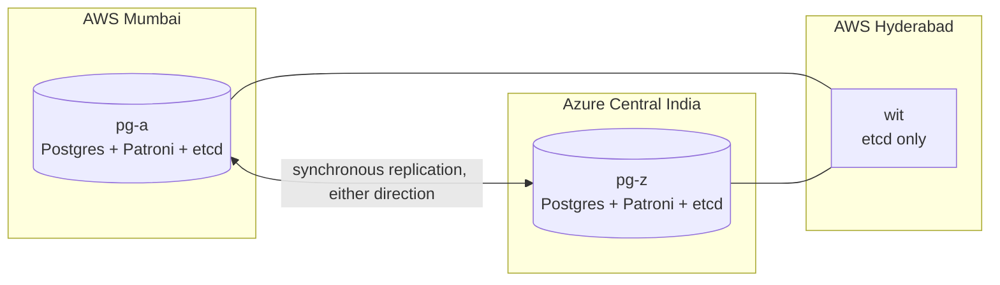

# Act 2, step 2: the database in both clouds — week 13

Oct 11, 2026. PostgreSQL now runs on `pg-a` (AWS Mumbai) and `pg-z` (Azure Central India) under Patroni, with synchronous replication while both are healthy. etcd, Patroni's consensus store, has a member on each and a third on the witness `wit` (AWS Hyderabad), so a failover needs a majority of three sites. Every service lists both database nodes and connects to whichever is primary (`target_session_attrs=read-write`, `connect_timeout=3` per node).

## Go-live gate

Each experiment ran on a GitHub runner (`experiment.yml`, `deploy/experiments/act1.sh`): the chaos harness loads the system through the public name and then runs its checker, while the release probe (about 10 requests a second, a new connection each, **never retried**, 10 s timeout) records what an outside client sees. A VM is stopped the way a crash takes it: forced, with no clean shutdown.

| Scenario | Checker (G1–G8) | Probe | Verdict |
| --- | --- | --- | --- |
| Five rollouts in a row with zero failed requests | — | five this week, 0 failed of 18,932; thirteen in a row since week 12 | ✅ |
| Crash the primary `pg-a`: failover AWS → Azure | ✅ PASS | 112 of 3,881 failed, all sent 3–20 s after the crash | ✅ safety; ⚠️ see below |
| Crash the primary `pg-z`: failover Azure → AWS | ✅ PASS | 113 of 3,784 failed, all sent 5–22 s after the crash | ✅ safety; ⚠️ see below |
| Cut the clouds apart for 2 minutes | ✅ PASS | 96 of 3,762 failed, all sent 7–33 s into the cut | ✅ majority kept the primary; ⚠️ see below |
| Stop the witness for 2 minutes | ✅ PASS | **0 of 4,211 failed** | ✅ |
| Replace the replica `pg-z` (`make infra REPLACE=pg-z`) | ✅ PASS | **0 of 12,076 failed** while it was taken away | ✅ (its rejoin came after the probe; see the bug below) |
| Replace the primary `pg-a`: switchover, replace, rejoin | ✅ PASS | **0 of 24,385 failed** over 40 minutes | ✅ |

**No acknowledged job was lost, duplicated or run by two leaders in any experiment**, and after each crash the old primary rejoined as the synchronous standby on its own (Patroni's `pg_rewind`). During the cut, Patroni's history shows no leader change: `pg-a` and the witness kept the primary, and `pg-z`, alone, never promoted itself.

### What the gate's wording doesn't hold to

The plan says a crash fails only the requests in flight on the failed component. For the database primary and for a cut between the clouds, it doesn't, and the reasons are mechanical:

- **A crashed primary leaves about 20 s with no primary.** Patroni promotes the replica only once the dead leader's key in etcd expires, and Patroni 4.1.5 refuses a `ttl` below 20 s. Requests that arrive in that window wait: `jobs` and `auth` retry database calls for up to 30 s (each attempt now bounded at 5 s), so a client with a 30 s timeout sees a slow request. The probe gives up at 10 s.
- **A cut between the clouds fails requests sent to the cut-off side until DNS stops returning it.** `svc-z`'s gateway reports not ready once its `jobs` can't reach the database, and Traffic Manager (a probe every 10 s, one failure tolerated, a 10 s TTL) takes 20–30 s to stop returning it. Setting `toleratedNumberOfFailures` to 0 would cut about 10 s, at the price of a single slow health check pulling a healthy gateway.

Planned events are unaffected: the leader's replacement, which includes a switchover, failed nothing in 24,385 requests. The promise is restated in `deployment_plan.md`'s known limits.

## How the cluster grows, shrinks and heals

- **Joining:** a new or replaced VM's etcd member joins the running cluster as a *learner* (it doesn't count toward quorum, so adding it can't stall the cluster) and is promoted once it has caught up. A replaced VM first removes its dead incarnation. Patroni then clones the primary.
- **Founding:** only a fresh session (`make up` on an empty state) founds a cluster. A member that can't reach its peers never starts a second cluster, because Patroni would then bootstrap a second primary on it. That rule mattered on the very first day: a new VM boots into the current release, and the previous release's `deploy.sh` would have let `pg-z` and `wit`, a majority of the new three, found their own cluster.
- **Addresses:** etcd and Patroni advertise mesh IPs. A container on the host network gets a copy of `/etc/hosts` when it starts, and the database containers are never restarted, so `pg-a` could never have resolved the new VMs by name.
- **Leaving on purpose:** before a replica is rebooted or replaced, Patroni's synchronous mode is switched off, so commits never wait for a node that is leaving; it is switched back on once the node streams again. `pg_healthy` (the rollout preflight and the sweep) requires a synchronous standby, so a cycle that fails halfway is noticed.
- **A standby cut off by the network** stops holding up commits after `wal_sender_timeout` (now 5 s, from 60 s), and Patroni drops it from synchronous replication. Patroni still promotes only an in-sync replica.

## Operations built this week

- **`make infra [REPLACE=vm]`** (`deploy/release/infra.sh`), from the admin machine: plan, then apply creates and in-place changes; a change to one existing VM goes through `cycle` (drain or hand over, apply, converge, back); several existing VMs at once, or removing a database VM, is refused. Every VM then refreshes its mesh. It runs from the admin machine rather than CI so the release role never holds the rights to create IAM roles and role assignments.
- **`maintenance.yml`**: a sweep every 15 minutes (every VM, both gateways in DNS, Patroni with a synchronous standby, every etcd member) that only alerts, since the public probe can't see a lost twin; and weekly rolling reboots for OS updates, the Patroni leader last.

## Bugs found on the way

In the [bug diary](../bugs.md):

- **The week-12 deadline fix missed the chore's own queries:** the scheduler could still hang forever in a reap on a dead connection. Found because the dead-connection test failed one run in three.
- **A replaced database VM couldn't rejoin etcd for 48 minutes:** after the witness-loss experiment, `pg-a`'s etcd still believed itself disconnected from `wit` and refused every membership change. Membership changes now ask each member in turn.
- **`run` (Run Command on AWS) waited forever when the command could not be sent**, as with a VM whose agent hadn't registered yet; `make infra REPLACE=pg-a` hung after the new `pg-a` had already rejoined, and its last steps (mesh refresh, synchronous mode back on) were finished by hand at 12:55–12:58. It now fails, and gives up after 1,000 s.
- **The experiment harness ran an older Go than `go.mod` requires** (a cached `golang:1.27`), so the first failover attempt never started its load. The image tag now comes from `go.mod`.

## Reports

| Scenario | Probe | Checker |
| --- | --- | --- |
| Failover AWS → Azure | [act2-failover-aws-to-azure-probe.md](act2-failover-aws-to-azure-probe.md) | [chaos-…7567-stop-leader.md](chaos-r1791707567154679040t1791707567-stop-leader.md) |
| Failover Azure → AWS | [act2-failover-azure-to-aws-probe.md](act2-failover-azure-to-aws-probe.md) | [chaos-…8202-stop-leader.md](chaos-r1791708202560826919t1791708202-stop-leader.md) |
| Cut the clouds apart | [act2-cut-clouds-probe.md](act2-cut-clouds-probe.md) | [chaos-…3302-cut-clouds.md](chaos-r1791713302243004950t1791713302-cut-clouds.md) |
| Witness lost | [act2-stop-wit-probe.md](act2-stop-wit-probe.md) | [chaos-…3897-stop-wit.md](chaos-r1791713897072174504t1791713897-stop-wit.md) |
| Replace `pg-z` | [act2-replace-pg-z-probe.md](act2-replace-pg-z-probe.md) | [chaos-…4565-watch.md](chaos-r1791714565172983612t1791714565-watch.md) |
| Replace `pg-a` | [act2-replace-pg-a-probe.md](act2-replace-pg-a-probe.md) | [chaos-…0047-watch.md](chaos-r1791720047015367060t1791720047-watch.md) |
